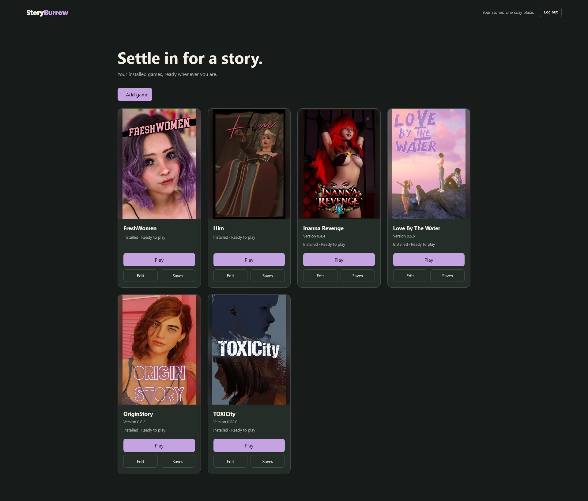
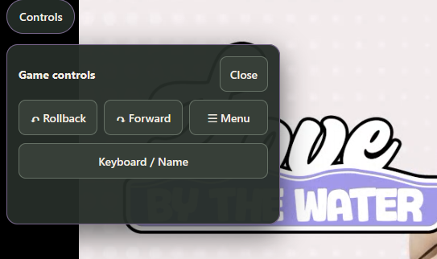
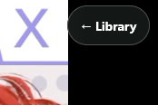

# StoryBurrow

**A self-hosted home for Ren’Py games.**



StoryBurrow runs Linux-compatible Ren’Py games on your own server and streams them to a browser on your local network. Your game installations, saves, and mods stay on the server instead of requiring separate game installations on each device.

I have been building Storyburrow slowly in my free time. It started because I simply got tired of juggling which games are on which devices and wanted to centralize it. My first run was just s docker container that i pointed at a game and played it. I got tired of managing it through ftp and ssh, so I built a python/flask UI around it. This project has spiraled so far out of my original goal I just had to share it, hoping someone else may use it. I'm also now breaking this down to *StoryBurrow Desktop* a local application thats just the UI and management without the streaming. I plan to release this for Windows, Linux, and probably Mac.

Developed by **Bitwicket** 

StoryBurrow does **not** include games or downloadable game content.

## What it does

StoryBurrow combines a Flask library interface, a virtual X11 display, and Selkies streaming. All games execute on the server; your browser displays video/audio and sends inputs back. No Ren’Py web conversion is done or required.

A managed installation has its own save namespace, separate from its game files. StoryBurrow can import installations, update them, inspect saves, preserve snapshots, and roll back retained game builds. I even built a save variable editor function, allowing you to tweak decisions and values in the UI

**Designed for a trusted home LAN.** StoryBurrow is not a storefront, game downloader, multi-tenant hosting service, or publicly hardened cloud platform. Do not forward its port directly to the internet; use a properly secured VPN or Secure Tunnel for remote access.
## Tested Clients
- Windows Desktop using Chrome and Firefox
  - Working Well!
- Rog Ally X using Windows
  - Working Well!
- Rog Ally X using Bazzite
  - Working Well!
- iPhone using Safari
  - Working Well as a [homepage webapp](https://support.apple.com/guide/iphone/open-as-web-app-iphea86e5236/ios)
  - Safari in landscape is not friendly at all. The browser tabs and address bar stay up giving you next to no playing space.

Please add any clients you test to the [discussion here!](https://github.com/bitwicket/StoryBurrow/discussions/3)

## Features and roadmap

I want to make this bigger and even more usable. Feel free to recommend features that you would use in addition to what is below!

### Implemented Features:
- Persistent Login. 
  - 1 account is required, at the end of the day the container is a running a full OS, balancing the risk of malicious injection selkies stream is only available where the account is logged in to StoryBurrow. Its not bulletproof but should mitigate well.
- Game Upload.
  - This was one of the biggest ones. You don't need to manage your games over ftp. The process accepts zipped or unzipped game folders that support linux.
- Game Managment.
  - Metadata matching isn't perfect. Theres is a page to correct the parsed name and version.
- Save Management.
  - StoryBurrow manages saves automatically. This lets me do things like editing, snapshots, rollback, export/import, etc.
- Game Updating
  - I'm so proud of this. On the edit page, you can upload a new build of the same game. This process makes a recoverable save snapshot, and offers to retain a recoverable version of the previous game for 48 hours. So if you upload a broken build, you can revert quickly and easily.
- VNDB Integration
  - When importing a a game, you can scroll through available covers from VNDB and confirm the want you want.
  - The main reason I rebased git before uploading. I assumed I needed the API key, but for basic game metadat you don't! so it wasn't needed. I wiped my key and carried on.
- Game Removal
  - You can remove games while retaining saves and metadata, or forget the game entirely like it had never been installed before. Both choices are clearly labeled and have different 'type to confirm' phrases.
- Installation IDs
  - Sometimes you want to have 2 version of a game running parallel instead of updating. Import does not check existing installs and saves are tied to the install's UUID, so they won't cross wires.

 ### Planned Features:

- Improved startup process. 
  - I don't like running docker exec command after the container goes up, but I don't want to persist passwords in .env or anywhere else.
- Add Game Via Link
  - Directly downloading a game from a patreon or itch.io link would be great. Its on the short list for a 1.0 release.
- Art Manger
  - The option to upload a cover yourself. The backbone is there, drop a file named `cover.png` in the game directory and it will be used, overriding a VNDB selection.
-  Mod Management
    - Add a mod or patch from the UI and persist the mod in the /mods/game-id structure so it can be easily reapplied to new versions.
    - Possibly a seperate holding pattern for [URM](https://0x52.dev/mods/Universal-Ren-Py-Mod-1000) and an option to install it per game.
-  Improved Input Handling
    -   Mobile is rough, I added a 'controls' element that can do simple things like back, forward, menu and keyboard if its hard to access in the game, and a 'return to library' button on the other side. These serve as a stopgap more than anything.
    
      
- Gallery UI
  - Primarily as a a place to put in-game screenshots. It would be fun to layer in unlocked images from the games, but that could get out of hand fast from many aspects, so I'm not sure how this will work yet. Call it a wishlist item.
- Other Game Engines
  - Adding RPGM for NLT games would be nice, but I need to do a lot of investigation on this. I know I would have to add a translation layer, and a good bit more logic to account for a whole new file structure. This is bottom of the list, but would be nice.
- Multiple Users/Instances
  - Right now that would require a seperate conatiner on a different port for each user. I'm not sure how feasible it is, but I'll explore it with enough interest.
- [itch.io](https://itch.io/) integration
  - Itch has an API that supports game listing and downloading. Incorporate this to allow StoryBurrow to directly grab games and updates.
- [GSL](https://gamestorylog.com/) Integration
  - Get ratings, tags, and artwork from the games and send reviews from StoryBurrow.
  - They don't currently have a public API, so there isn't much to do here, but I'm keeping it as a wishful thought!


## Requirements

- Linux host with Docker Engine and Docker Compose.
- Enough disk space for game installations, uploads, and any temporarily retained previous builds if you use them.
- Linux-compatible Ren’Py games containing a `.sh` launcher. Windows-only executables are not run directly.
- A client with access to the host over your LAN.
- Appropriate graphics device support/permissions for the GPU passthrough configuration selected in Compose.

Intel and AMD Linux GPU devices generally use `/dev/dri` plus a render group. NVIDIA requires its host driver and NVIDIA Container Toolkit configuration. Hardware access and video encoding capabilities depend on the host and Selkies; software-only operation has not yet been validated as a general default. PLEASE LET ME KNOW IF YOU TRY IT!

In my testing, with quicksync passed through, I never experienced a noticable jump in usage or temperature. I'd love to hear other experiences!

## Installation and first run

### 1. Prepare the configuration

#### Dockerhub image:
Download/Copy `docker-compose.yml` and `.env.example` as `.env` to your prefered compose location.

Set Variables in .env as described below.

#### Local Build
Clone the repository and create a local `.env` file from the provided example using `docker-compose.local.yml`
```bash
git clone https://github.com/Bitwicket/StoryBurrow.git
cd StoryBurrow
cp .env.example .env
```
Set Variables in .env as described below.


Edit `.env` to set `STORYBURROW_HOST` to the **LAN IP address or hostname users will actually visit**, `STORYBURROW_PORT`, timezone, display dimensions, and `RENDER_GID` for the default Intel/AMD passthrough. Follow the comments in `.env.example` to discover the correct render group ID; do not assume a particular numeric ID.

### 2. Start StoryBurrow

#### Dockerhub image

```bash
docker compose pull
docker compose up -d
```

#### Local Build

```bash
docker compose -f docker-compose.local.yml up -d --build
```

Only the StoryBurrow HTTPS web port (container `2500`) needs to be published. Selkies (`6080`) is proxied internally through Caddy; **do not publish `6080` separately**.

### 3. Create the administrator account

On a fresh installation, the browser will indicate that administrator setup is required. Run this command on the Docker host if you didn't change anything:

```bash
docker exec -it -u ubuntu storyburrow /opt/storyburrow-venv/bin/python /app/authctl.py init admin
```
If you did change the container name, reference it instead of `storyburrow` in the above command. If you would like a username other than `admin` make that change as well.

This initializes the administrator account named `admin` and prompts for its password interactively. **Do not put a password on the command line or in Compose.** The account data is stored under `/data/auth` and should persist through container rebuilds as long as `/data` is mounted persistently.

### 4. Open the library

Visit `https://<your-server-address>:<STORYBURROW_PORT>` (normally port `2500`), accept or trust the local HTTPS certificate as appropriate for your own network, and sign in with the administrator credentials you just created.

Select **Add game** to import a Linux-compatible Ren’Py game. Only import games that you are permitted to use.

## Saves, snapshots, and rollback

**Active managed saves** live outside the installed game build. Updating a game creates a permanent pre-update save snapshot and does not automatically replace or roll back current saves.

| Recovery data | Retention |
| --- | --- |
| Pre-update and imported save snapshots | Until manually deleted |
| Temporary save recovery copies (including variable edits) | 24 hours |
| Full previous game build | Optional, up to 48 hours after a successful update |

During an update, you may choose whether to keep the old build for 48 hours. The previous build is held temporarily during the update transaction even if you opt out. Retained builds can be rolled back or deleted early from **Edit Game → Manage previous builds**. Backup expiration is handled by periodic application checks; an idle server may not remove a backup at the exact expiry second.

In **Save Manager → Snapshots**, you can export a snapshot ZIP, import it again later, restore snapshot files, or delete a snapshot permanently. Importing a snapshot **does not** automatically restore it to active saves.

In **Edit Game**, **Uninstall** removes the game files but keeps managed save data. **Forget game completely** removes the installation and verified installation-owned managed saves, snapshots, recovery data, and registered previous builds. Unregistered old development backups or external legacy save folders are not guessed at or deleted.

A rollback of a game build **does not roll back saves**. If a game version requires an older save, restore it separately from Save Manager. Changes to saves and save variables can cause incompatibilities, and modified saves may prompt Ren’Py to ask for device trust; approve such prompts only for saves you recognize.

Keep independent backups of saves and configuration that matter to you. Built-in recovery is not a substitute for your own backup plan.

## Limitations

- This is built by me and tested by me. I have tested with GPU passthrough and squashed every bug I found. Please open and issue if you find some!
- One active game session per StoryBurrow instance.
- Linux Ren’Py launchers only; no direct Windows executable support.
- Save-variable editing is limited to supported simple values, not arbitrary Ren’Py/Python objects.
- Save management is disabled while a game is running. Avoid launching from another browser during save write operations.
- Streaming and touch controls vary across games, browsers, and hardware.
- The built-in login and locally terminated HTTPS are intended for LAN deployments, **not direct internet exposure**.

## Documentation and project layout
I will be adding more to /docs over the next couple of days while I let the project breath as I use it and find more bugs. I'll update this as I do so resources can easily be found!

The container includes `authctl.py` for administrator setup and `gamectl.py` for emergency game controls.

### Check the current game session
docker exec -u ubuntu storyburrow python3 /app/gamectl.py status

### List available games
docker exec -u ubuntu storyburrow python3 /app/gamectl.py list

### Start a game (use its installation directory name)
docker exec -u ubuntu storyburrow python3 /app/gamectl.py start %gamename%

### Stop the currently running game
docker exec -u ubuntu storyburrow python3 /app/gamectl.py stop

## Contributing and issues

Bug reports are welcome. Include the StoryBurrow version, relevant sanitized container logs, and reproduction steps. **Do not upload personal save files, secrets, credentials, signing keys, or copyrighted game archives to public issues.**

## Credits and licensing

Primary Testing Game: [Love By The Water](https://curebtw.itch.io/lbtw) from Cure and Pickle. A great game from great people that were gracious enough to let me use their game in screenshots. 

Developed by **Bitwicket** using Flask, Selkies, Caddy, and Ren’Py-compatible tooling. Each upstream project retains its own license and trademarks. StoryBurrow does not distribute third-party games or claim ownership of their content.

