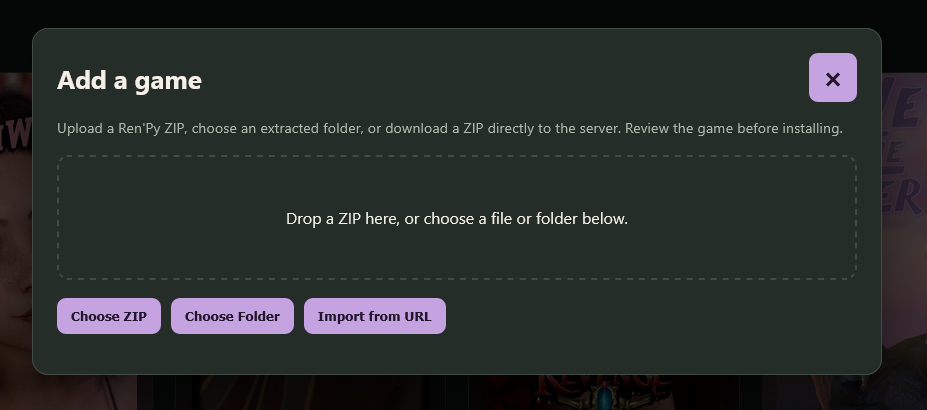
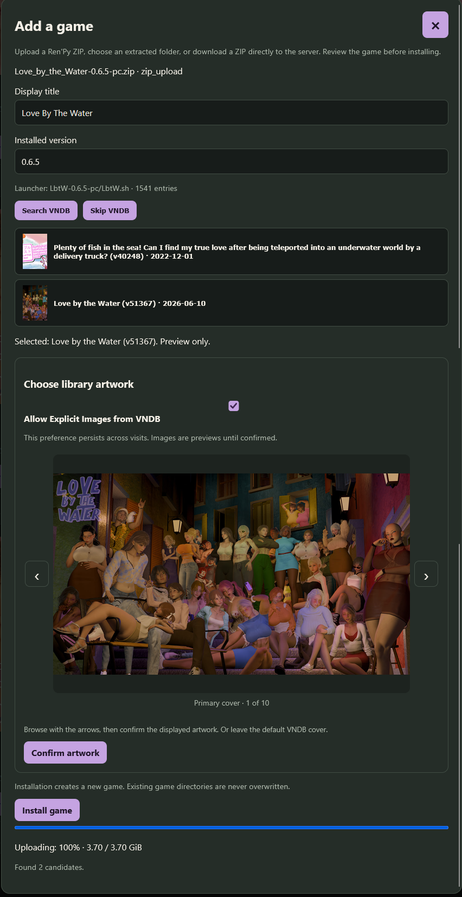

# Add Games - Upload Games to StoryBurrow

The Main Way of Adding Games. Accepts ZIP, Folder, or URL (with some restrictions).
- URL is currently limited to: MEGA.nz (subject to 5GB quota), gofile.io, or direct download link. (try right-clicking and copying link on the download button from your hoster.)

After uploading a game, you get an install confirmation page. This is a moment to ensure the right game, version and pick artwork.

Name and Version are parsed to a decent confidence, and editable if not correct.

Search VNDB will check VNDB API for the name currently in the name box, so any changes you make will be searched. You can then select a picture from those available for the cover art. Confirm artwork to cache the one currently visible. Then Install Game to full transfer the upload from staging to full availability.

