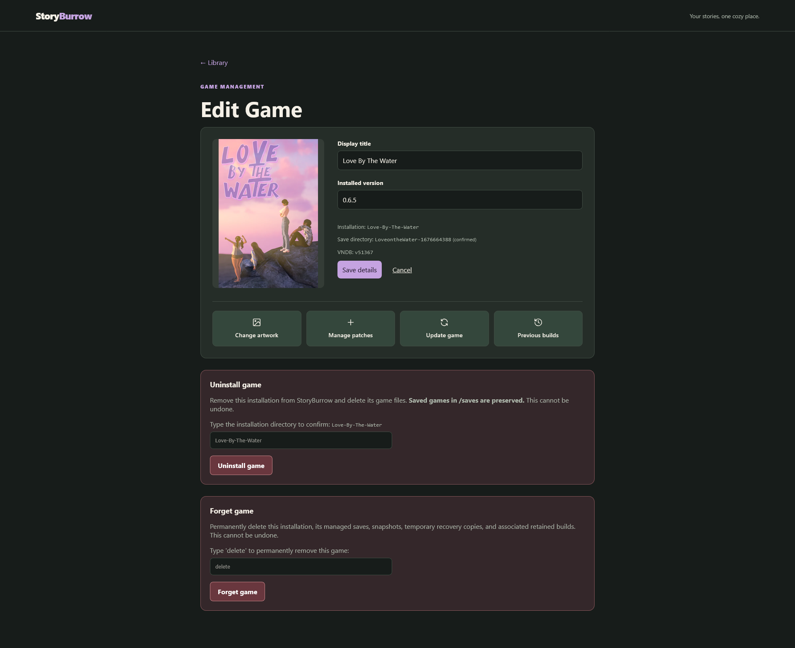

# Edit Game - Full Game Management

This is a place to change game details. Title and version are front and center. All options explained below.

- Change Artwork - As advertised, updates the game image
    - Re-Pick from VNDB, Upload File, or Give URL.
- Manage Patches - Mods and Update Only Patches.
    - Appends file to the existing installation, replacing anything that exists.
    - Rollback changed files. If you upload a mod that breaks your game, you can undo them with the "Revert" Option
- Update Game - This is a Full replacement.
    - This erases the install, and replaces it with provided files. Keeping the saves and information the same. All mods/patches are removed. Very Useful for season-to-season releases. Saves are also "snapshotted" for rollback.
- Previous Builds - Rollback after the "Update Game" procedure. Optionally kept for 48 hours. 
- Uninstall Game - Deletes the game files, keeps metadata and saves. 
- Forget Game - Deletes game files, saves, and metadata as if the game had never been installed.

