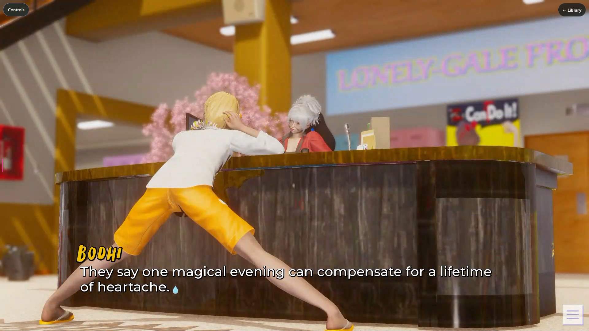
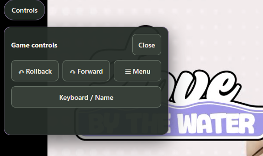
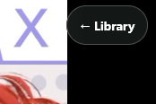

# The Player - The Whole Reason This Exists

The player is exactly what it says on the label. Selkies captures a window running in the container and broadcasts it via websocket to a browser. 

2 Things have been added primarily to assist mobile use:

1. Controls - This is a little popup that has things like rollback, and open menu. There is also a keyboard. On my testing, getting a phone keyboard to respond to prompts in game (name, save name, etc.) was finnicky at best. This is the workaround while I find a better solution.
2. <- Library - This returns to library if you can't quit or close the game for any reason. Save the game and go back to the Library and you can kill the game there with the "Stop Game" button.

 